# Motorpool System - User Manual

> **Version:** 1.0  
> **Last Updated:** January 2026

---

## Table of Contents

1. [Introduction](#1-introduction)
2. [Getting Started](#2-getting-started)
   - [System Requirements](#21-system-requirements)
   - [Creating an Account](#22-creating-an-account)
   - [Logging In](#23-logging-in)
   - [Forgot Password](#24-forgot-password)
3. [Dashboard](#3-dashboard)
4. [Vehicle Management](#4-vehicle-management)
   - [Viewing Vehicles](#41-viewing-vehicles)
   - [Adding a New Vehicle](#42-adding-a-new-vehicle)
   - [Editing a Vehicle](#43-editing-a-vehicle)
   - [Deleting a Vehicle](#44-deleting-a-vehicle)
   - [Exporting Vehicle Data](#45-exporting-vehicle-data)
5. [Maintenance Records](#5-maintenance-records)
   - [Viewing Maintenance Records](#51-viewing-maintenance-records)
   - [Adding a Maintenance Record](#52-adding-a-maintenance-record)
   - [22-Point Checklist](#53-22-point-checklist)
   - [Viewing Maintenance Details](#54-viewing-maintenance-details)
   - [Exporting Maintenance Data](#55-exporting-maintenance-data)
6. [Repair Records](#6-repair-records)
   - [Viewing Repair Records](#61-viewing-repair-records)
   - [Adding a Repair Record](#62-adding-a-repair-record)
   - [Viewing Repair Details](#63-viewing-repair-details)
   - [Exporting Repair Data](#64-exporting-repair-data)
7. [Trip Tickets](#7-trip-tickets)
   - [Viewing Trip Tickets](#71-viewing-trip-tickets)
   - [Creating a Trip Ticket](#72-creating-a-trip-ticket)
   - [Editing a Trip Ticket](#73-editing-a-trip-ticket)
   - [Viewing Trip Ticket Details](#74-viewing-trip-ticket-details)
   - [Exporting Trip Tickets](#75-exporting-trip-tickets)
8. [Calendar](#8-calendar)
   - [Calendar View](#81-calendar-view)
   - [List View](#82-list-view)
   - [Navigating the Calendar](#83-navigating-the-calendar)
9. [Notifications](#9-notifications)
   - [Viewing Notification Logs](#91-viewing-notification-logs)
   - [Filtering Notifications](#92-filtering-notifications)
   - [Retrying Failed Notifications](#93-retrying-failed-notifications)
   - [Archiving Notifications](#94-archiving-notifications)
10. [Approval Workflow](#10-approval-workflow)
    - [For Staff Users](#101-for-staff-users)
    - [For Administrators](#102-for-administrators)
11. [User Management (Admin Only)](#11-user-management-admin-only)
    - [Viewing Users](#111-viewing-users)
    - [Creating a New User](#112-creating-a-new-user)
    - [Approving/Rejecting Users](#113-approvingrejecti-users)
    - [Resetting User Password](#114-resetting-user-password)
12. [Activity Logs (Admin Only)](#12-activity-logs-admin-only)
13. [Profile Management](#13-profile-management)
    - [Updating Profile Information](#131-updating-profile-information)
    - [Changing Password](#132-changing-password)
14. [User Roles and Permissions](#14-user-roles-and-permissions)
15. [Troubleshooting](#15-troubleshooting)

---

## 1. Introduction

The **Motorpool System** is a comprehensive web-based application designed to manage fleet vehicles, track maintenance and repair records, handle trip tickets, and automate maintenance notifications. The system supports multiple user roles with different access levels to ensure proper authorization and workflow management.

### Key Features

- **Vehicle Management** – Track all fleet vehicles with detailed information
- **Maintenance Tracking** – Log maintenance activities with a 22-point checklist
- **Repair Records** – Document repair work and associated costs
- **Trip Tickets** – Manage vehicle trip requests and tracking
- **Calendar View** – Visual overview of maintenance schedules and trips
- **Automated Notifications** – Email alerts for upcoming maintenance
- **Approval Workflow** – Staff submissions require admin approval
- **Export Capabilities** – Export data to CSV and Excel formats
- **Activity Logging** – Track all system activities for audit purposes

*Figure 1.1: Motorpool System Overview*

---

## 2. Getting Started

### 2.1 System Requirements

To access the Motorpool System, you need:

- A modern web browser (Chrome, Firefox, Safari, or Edge)
- Stable internet connection
- Valid user credentials

*Figure 2.1: Supported Browsers*

### 2.2 Creating an Account

New users can register for an account through the registration page.

**Steps to Register:**

1. Navigate to the system URL
2. Click **"Register"** on the login page
3. Fill in the required information:
   - **Name** – Your full name
   - **Email** – A valid email address
   - **Password** – At least 8 characters
   - **Confirm Password** – Re-enter your password
4. Click the **"Register"** button
5. Wait for an administrator to approve your account

> **Note:** New accounts require administrator approval before you can access the system. You will receive an email notification once your account is approved.

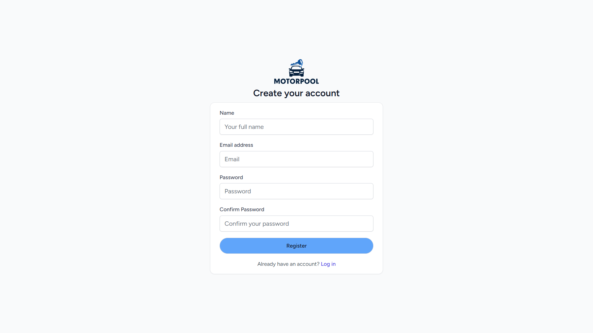
*Figure 2.2: Registration Page*

### 2.3 Logging In

Once your account is approved, you can log in to the system.

**Steps to Log In:**

1. Navigate to the system URL
2. Enter your **Email** address
3. Enter your **Password**
4. (Optional) Check **"Remember me"** to stay logged in
5. Click the **"Log in"** button

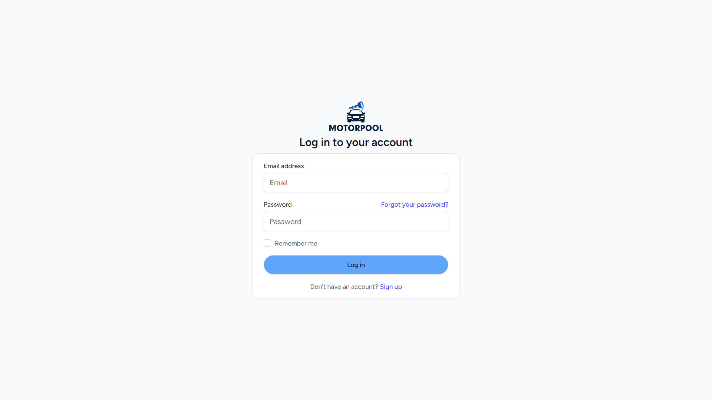
*Figure 2.3: Login Page*

### 2.4 Forgot Password

If you forget your password, you can reset it via email.

**Steps to Reset Password:**

1. On the login page, click **"Forgot your password?"**
2. Enter your registered email address
3. Click **"Email Password Reset Link"**
4. Check your email for the reset link
5. Click the link and enter your new password
6. Confirm the new password and submit

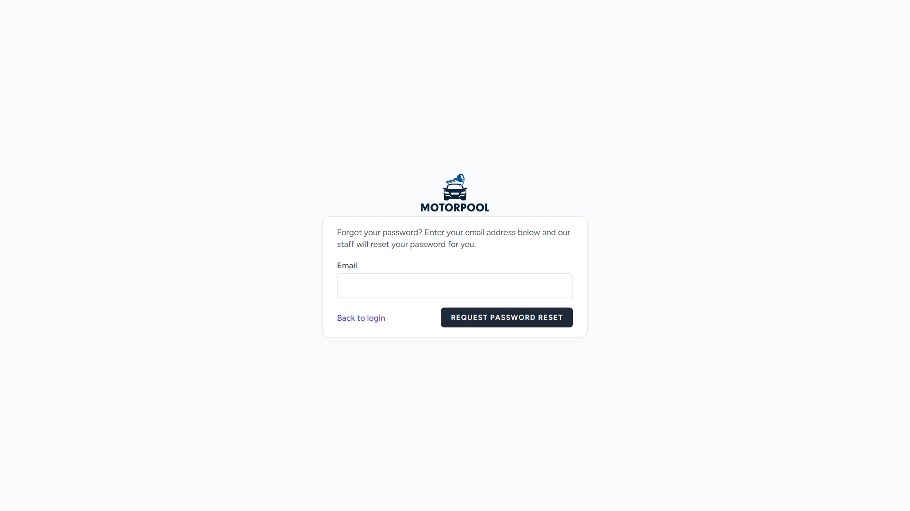
*Figure 2.4: Forgot Password Page*

---

## 3. Dashboard

The Dashboard provides an at-a-glance overview of your motorpool system. The information displayed varies based on your user role.

### Dashboard Components

- **Total Vehicles** – Number of vehicles in the system
- **Maintenance Records** – Total maintenance activities logged
- **Upcoming Maintenance** – Vehicles due for maintenance soon
- **Overdue Maintenance** – Vehicles past their maintenance due date
- **Upcoming Maintenance List** – Next 5 vehicles scheduled for maintenance
- **Recent Maintenance** – Last 5 maintenance activities performed
- **Recent Notifications** – Latest notification logs (Staff/Admin only)

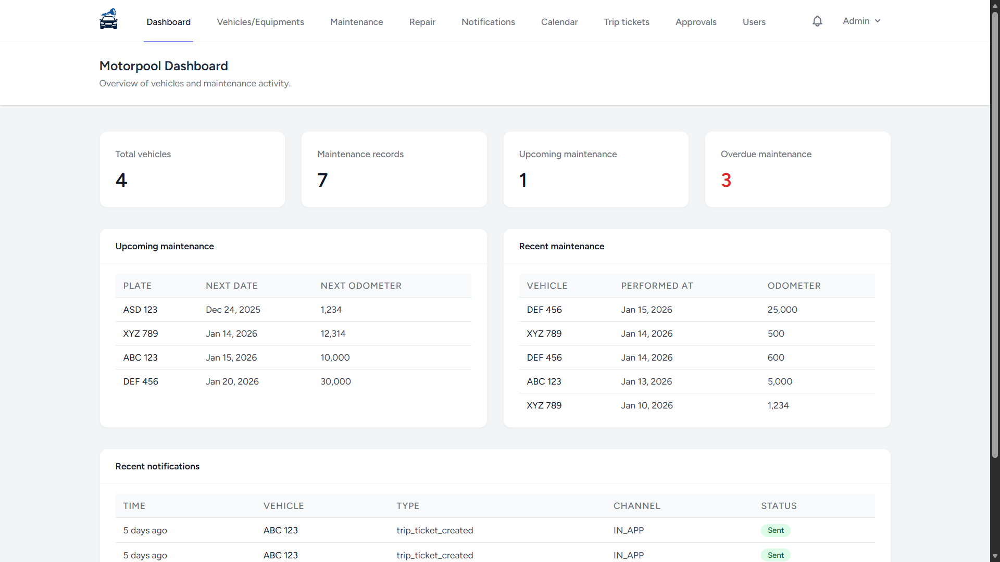
*Figure 3.1: Dashboard Overview*

### Dashboard Cards

| Card | Description |
|------|-------------|
| Total Vehicles | Count of all registered vehicles |
| Maintenance Records | Total number of maintenance entries |
| Upcoming Maintenance | Vehicles with maintenance due in the future |
| Overdue Maintenance | Vehicles past their scheduled maintenance date |

*Figure 3.2: Dashboard Summary Cards*

---

## 4. Vehicle Management

The Vehicle Management module allows you to manage all fleet vehicles in the system.

### 4.1 Viewing Vehicles

Access the vehicles list from the main navigation menu.

**Features:**

- **Search** – Search vehicles by plate number, make, or model
- **Filter by Status** – Filter by Operational, Non-operational, or Maintenance
- **Sort** – Click column headers to sort the list
- **Pagination** – Navigate through pages of vehicles

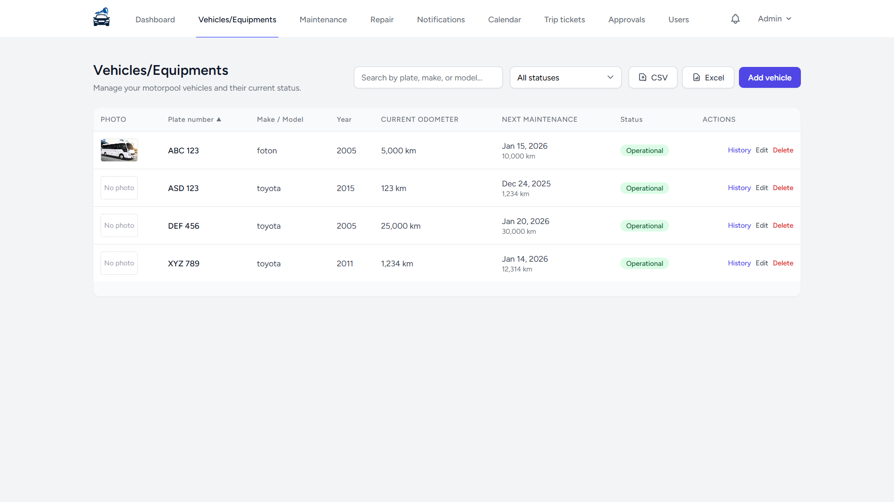
*Figure 4.1: Vehicles List Page*

### 4.2 Adding a New Vehicle

**Steps to Add a Vehicle:**

1. Click the **"Add vehicle"** button
2. Fill in the vehicle details:
   - **Vehicle Type** – Type of vehicle (e.g., Sedan, SUV, Truck)
   - **Plate Number** – Unique vehicle plate number
   - **Chassis Number** – Vehicle chassis/VIN number
   - **Make** – Vehicle manufacturer
   - **Model** – Vehicle model name
   - **Year** – Manufacturing year
   - **Engine Number** – Engine identification number
   - **Driver/Operator** – Assigned driver name
   - **Contact Number** – Driver's contact number
   - **Status** – Operational, Non-operational, or Maintenance
   - **Assigned User** – Link to a system user (optional)
   - **Photo** – Upload a vehicle photo (optional)
3. Click **"Save vehicle"**

> **Note for Staff Users:** Your submission will be sent for admin approval instead of being saved immediately.

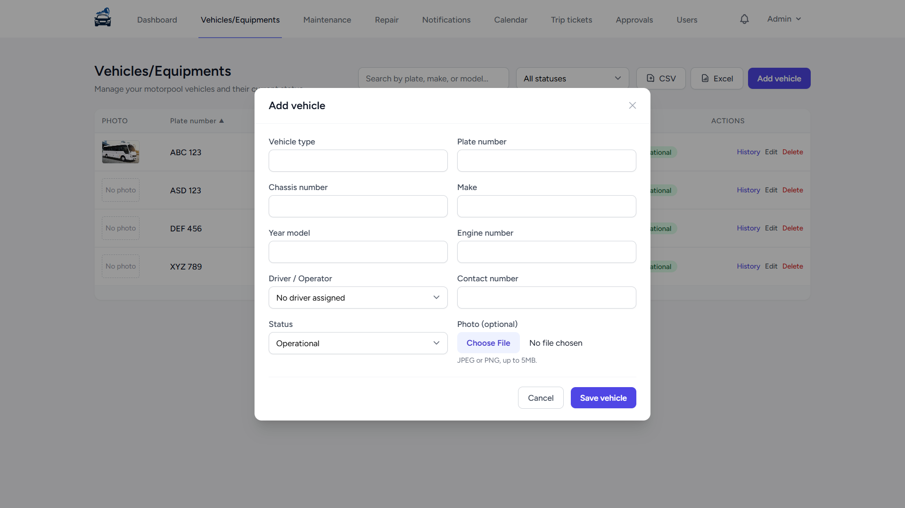
*Figure 4.2: Add Vehicle Form*

### 4.3 Editing a Vehicle

**Steps to Edit a Vehicle:**

1. Find the vehicle in the list
2. Click the **"Edit"** button on the vehicle row
3. Modify the desired fields
4. Click **"Save vehicle"**

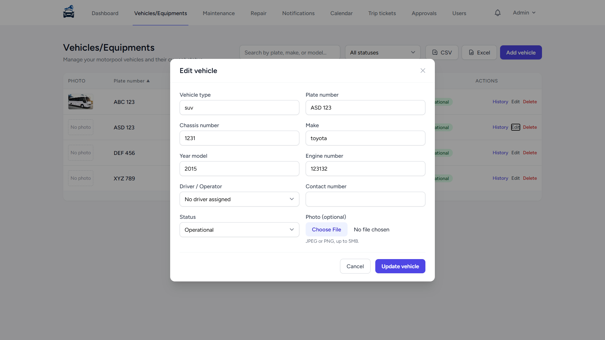
*Figure 4.3: Edit Vehicle Form*

### 4.4 Deleting a Vehicle

**Steps to Delete a Vehicle:**

1. Find the vehicle in the list
2. Click the **"Delete"** button
3. Confirm the deletion in the confirmation dialog

> **Warning:** Deleting a vehicle is permanent and cannot be undone. All associated records may be affected.

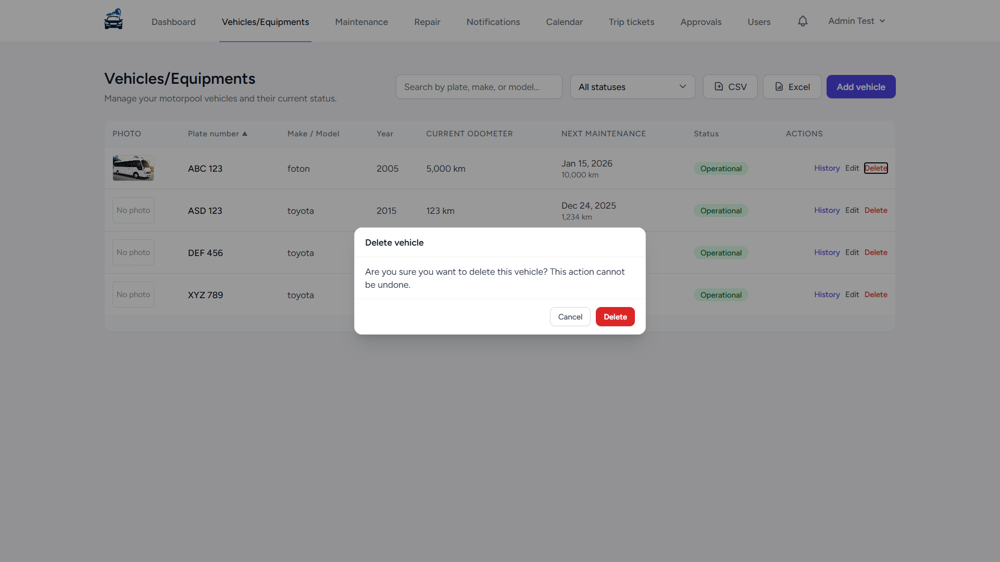
*Figure 4.4: Delete Confirmation Dialog*

### 4.5 Exporting Vehicle Data

Export the vehicle list to CSV or Excel format.

**Steps to Export:**

1. (Optional) Apply filters to narrow down the data
2. Click **"CSV"** or **"Excel"** button
3. The file will download automatically

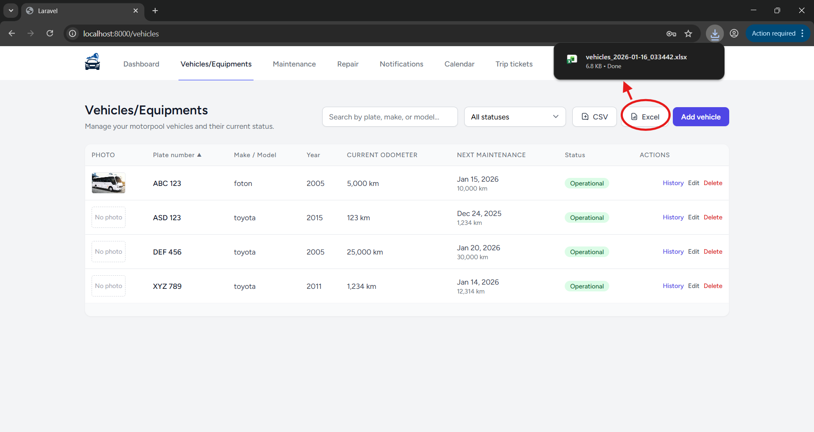
*Figure 4.5: Export Options*

---

## 5. Maintenance Records

The Maintenance module tracks all preventive maintenance activities performed on vehicles.

### 5.1 Viewing Maintenance Records

Access maintenance records from the main navigation menu.

**Features:**

- **Filter by Vehicle** – Select a specific vehicle
- **Sort** – Sort by date, odometer, or cost
- **Pagination** – Navigate through records

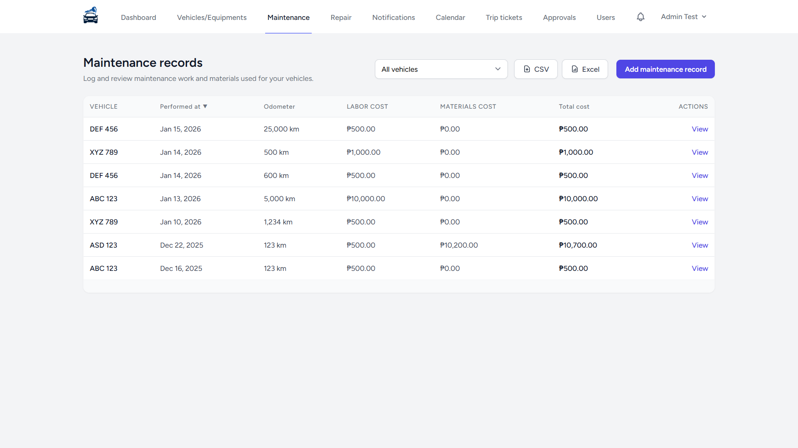
*Figure 5.1: Maintenance Records List*

### 5.2 Adding a Maintenance Record

**Steps to Add a Maintenance Record:**

1. Click **"Add maintenance record"**
2. Fill in the details:
   - **Vehicle** – Select the vehicle
   - **Performed at** – Date of maintenance
   - **Odometer Reading** – Current odometer value
   - **Labor Cost** – Personnel labor cost
   - **Next Maintenance Date** – Scheduled next maintenance
   - **Next Maintenance Odometer** – Odometer for next maintenance
   - **Performed by** – Name of person who performed maintenance
   - **Description of Work** – Details of work performed
3. Complete the **22-Point Checklist** (see section 5.3)
4. Add **Materials Used** (optional):
   - Click **"Add material"**
   - Enter material name, part number, quantity, and cost
5. Click **"Save maintenance record"**

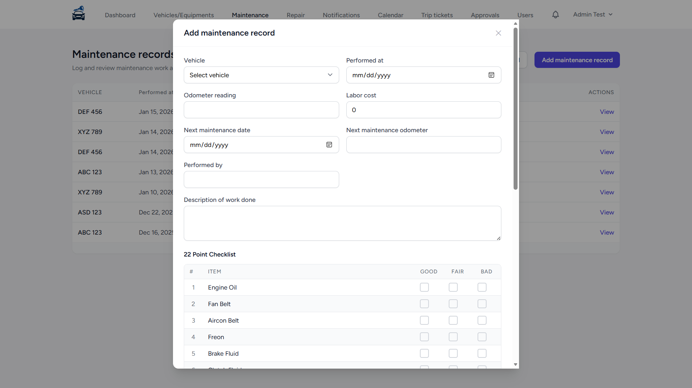
*Figure 5.2: Add Maintenance Record Form*

### 5.3 22-Point Checklist

The maintenance form includes a comprehensive 22-point inspection checklist. For each item, select one status: **Good**, **Fair**, or **Bad**.

**Checklist Items:**

| # | Item | Description |
|---|------|-------------|
| 1 | Engine Oil | Check oil level and condition |
| 2 | Fan Belt | Inspect belt condition and tension |
| 3 | Aircon Belt | Check AC belt condition |
| 4 | Freon | Check refrigerant level |
| 5 | Brake Fluid | Check brake fluid level |
| 6 | Clutch Fluid | Check clutch fluid level |
| 7 | Power Steering Fluid | Check power steering fluid |
| 8 | A.T.F. | Check automatic transmission fluid |
| 9 | Coolant | Check engine coolant level |
| 10 | Windshield Washer | Check washer fluid |
| 11 | Radiator Hoses | Inspect hose condition |
| 12 | Radiator Cap | Check cap seal and pressure |
| 13 | Battery H2O / Terminal | Check battery water and terminals |
| 14 | Air Filter | Inspect air filter condition |
| 15 | Lights | Test all vehicle lights |
| 16 | Engine Idling Speed | Check engine idle RPM |
| 17 | Wiper Blade | Inspect wiper blade condition |
| 18 | Tire Pressure | Check tire pressure all wheels |
| 19 | Chassis Lubrication | Lubricate chassis points |
| 20 | Oil Filter | Check/replace oil filter |
| 21 | Transmission Fluid | Check transmission fluid |
| 22 | Differential Fluid | Check differential oil |

**How to Use the Checklist:**

- Click on **Good** (green), **Fair** (yellow), or **Bad** (red) for each item
- Click the same status again to deselect
- Only items with a selected status are saved

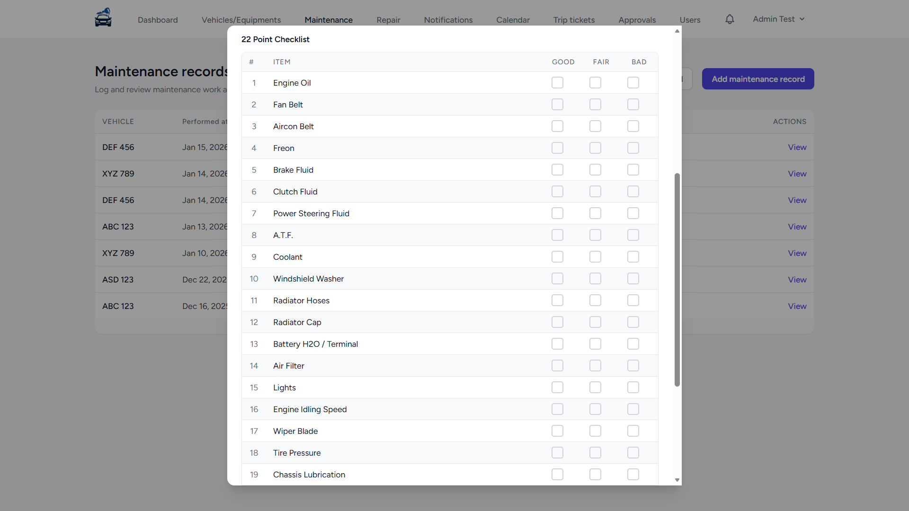
*Figure 5.3: 22-Point Maintenance Checklist*

### 5.4 Viewing Maintenance Details

Click **"View"** on any maintenance record to see full details including:

- Vehicle information
- Maintenance details and costs
- 22-Point Checklist results (with color-coded status badges)
- Materials used with itemized costs

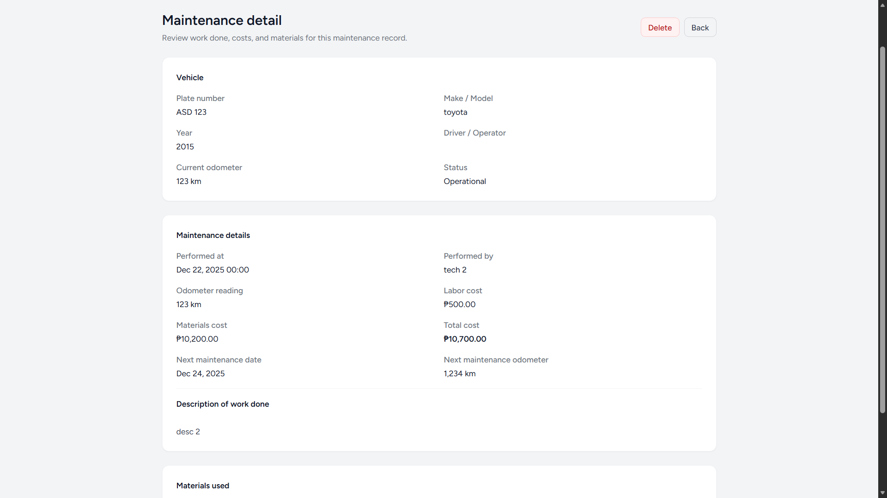
*Figure 5.4: Maintenance Record Details*

### 5.5 Exporting Maintenance Data

Export maintenance records to CSV or Excel format.

1. (Optional) Filter by vehicle
2. Click **"CSV"** or **"Excel"** button
3. Download begins automatically

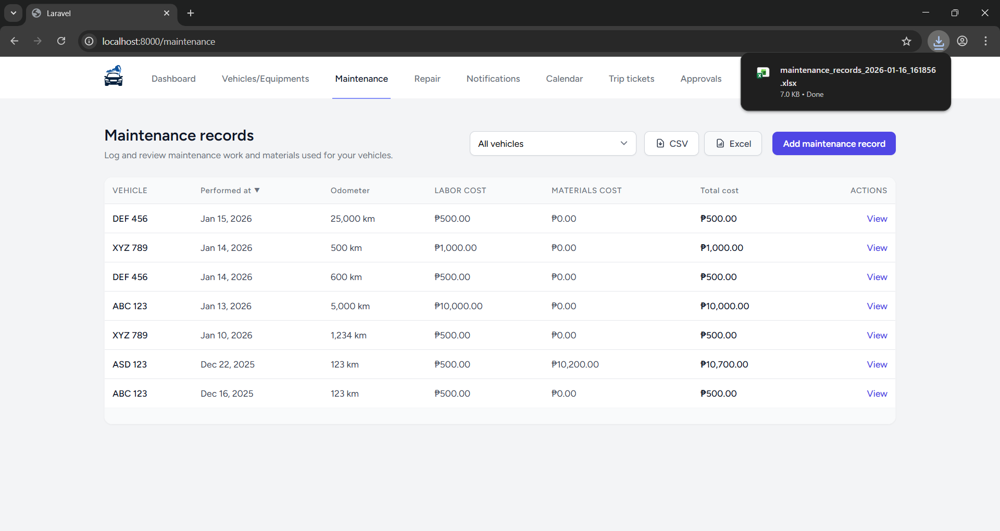
*Figure 5.5: Export Maintenance Options*

---

## 6. Repair Records

The Repair module tracks unscheduled repairs and fixes performed on vehicles.

### 6.1 Viewing Repair Records

Access repair records from the main navigation menu.

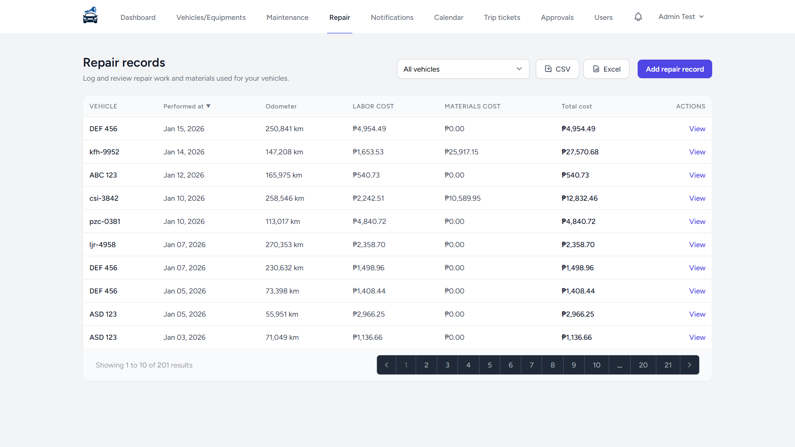
*Figure 6.1: Repair Records List*

### 6.2 Adding a Repair Record

**Steps to Add a Repair Record:**

1. Click **"Add repair record"**
2. Fill in the details:
   - **Vehicle** – Select the vehicle
   - **Performed at** – Date of repair
   - **Odometer Reading** – Current odometer
   - **Labor Cost** – Repair labor cost
   - **Performed by** – Technician name
   - **Description of Work** – Repair details
3. Add **Materials Used** (optional)
4. Click **"Save repair record"**

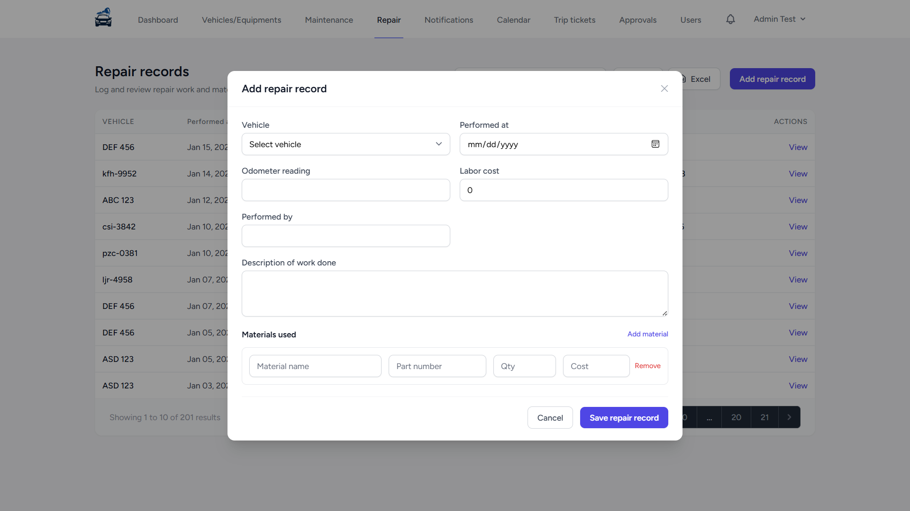
*Figure 6.2: Add Repair Record Form*

### 6.3 Viewing Repair Details

Click **"View"** on any repair record to see:

- Vehicle information
- Repair details and costs
- Materials used

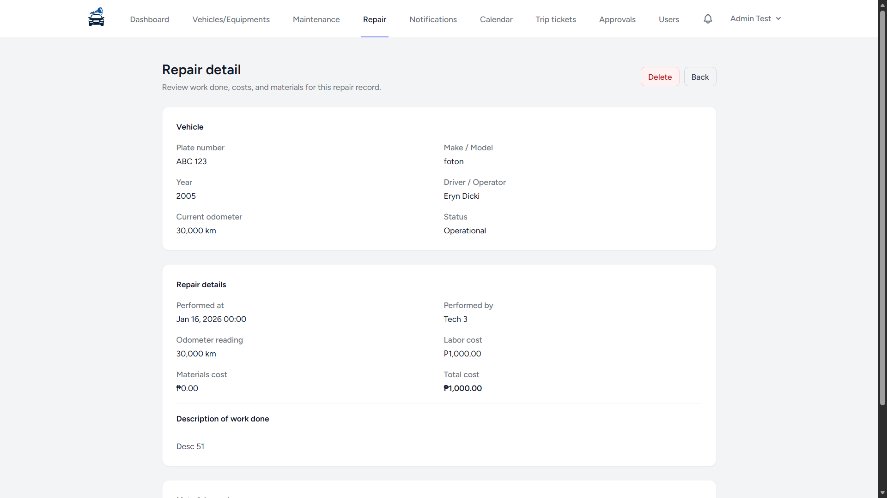
*Figure 6.3: Repair Record Details*

### 6.4 Exporting Repair Data

Export repair records to CSV or Excel format.

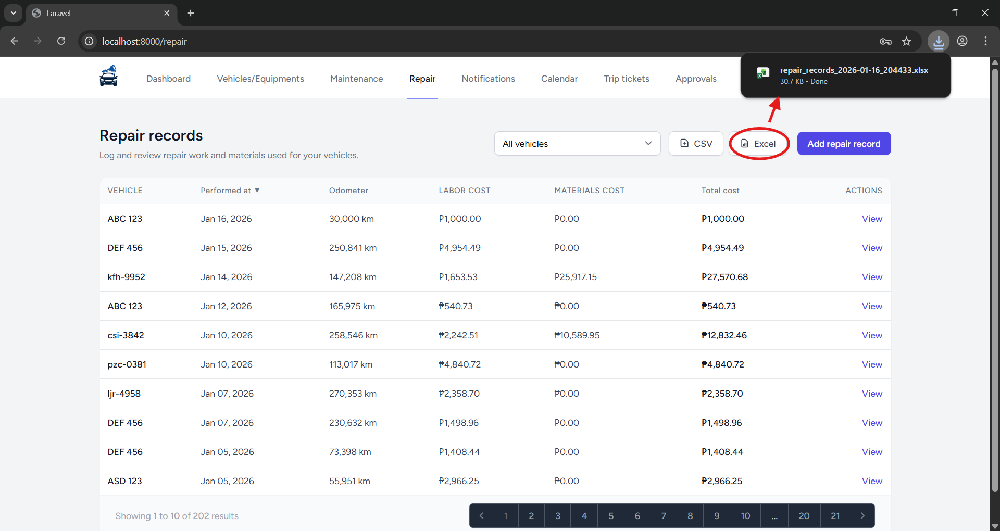
*Figure 6.4: Export Repair Options*

---

## 7. Trip Tickets

The Trip Tickets module manages vehicle usage requests and trip documentation.

### 7.1 Viewing Trip Tickets

Access trip tickets from the main navigation menu.

**Features:**

- **Filter by Vehicle** – Select a specific vehicle
- **Filter by Status** – Pending, Approved, Completed, Cancelled
- **Search** – Search by destination or driver name
- **Pagination** – Navigate through records

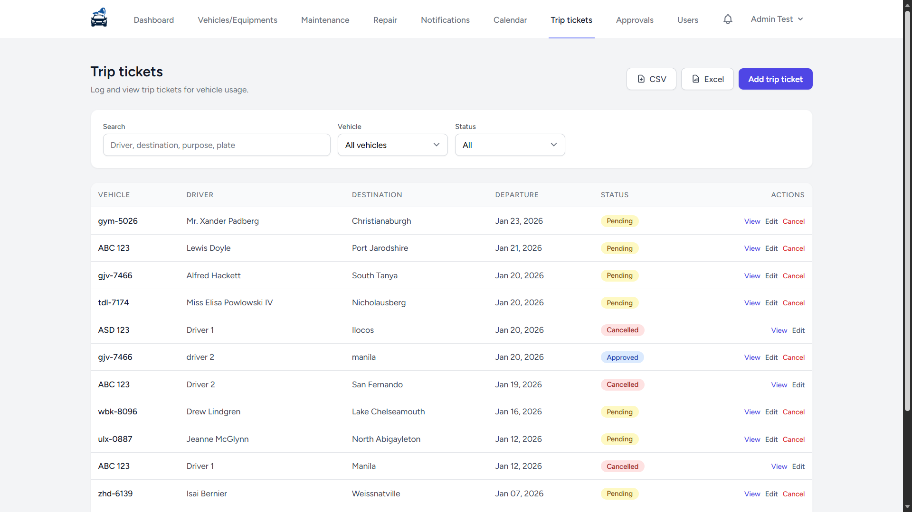
*Figure 7.1: Trip Tickets List*

### 7.2 Creating a Trip Ticket

**Steps to Create a Trip Ticket:**

1. Click **"Create trip ticket"**
2. Fill in the details:
   - **Vehicle** – Select the vehicle to use
   - **Driver Name** – Name of the driver
   - **Destination** – Trip destination
   - **Purpose** – Purpose of the trip
   - **Travel Date** – Date of travel
   - **Odometer Start** – Starting odometer (optional)
   - **Odometer End** – Ending odometer (optional)
3. Click **"Save trip ticket"**

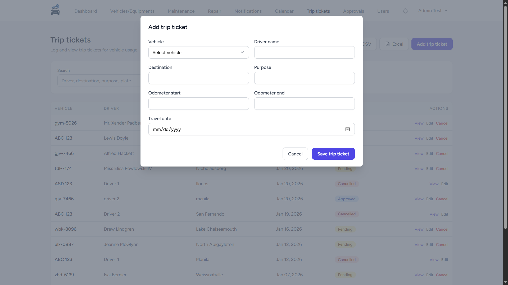
*Figure 7.2: Create Trip Ticket Form*

### 7.3 Editing a Trip Ticket

**Steps to Edit:**

1. Find the trip ticket in the list
2. Click **"Edit"**
3. Modify the necessary fields
4. Click **"Save trip ticket"**

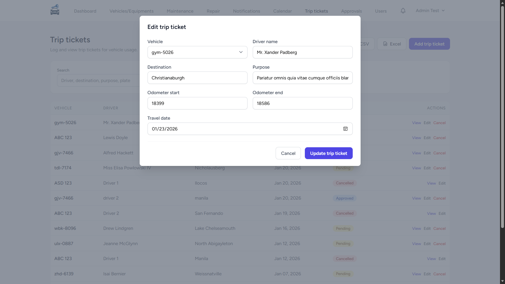
*Figure 7.3: Edit Trip Ticket*

### 7.4 Viewing Trip Ticket Details

Click **"View"** to see complete trip ticket information.

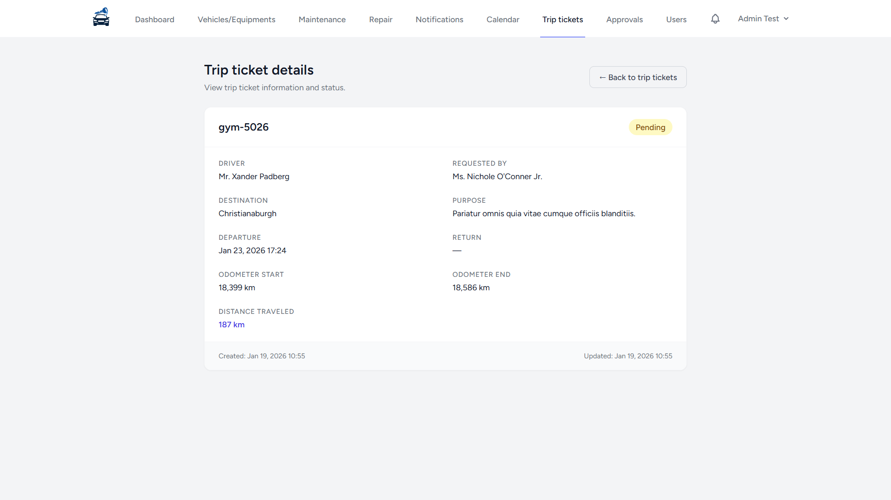
*Figure 7.4: Trip Ticket Details*

### 7.5 Exporting Trip Tickets

Export trip tickets to CSV or Excel format.

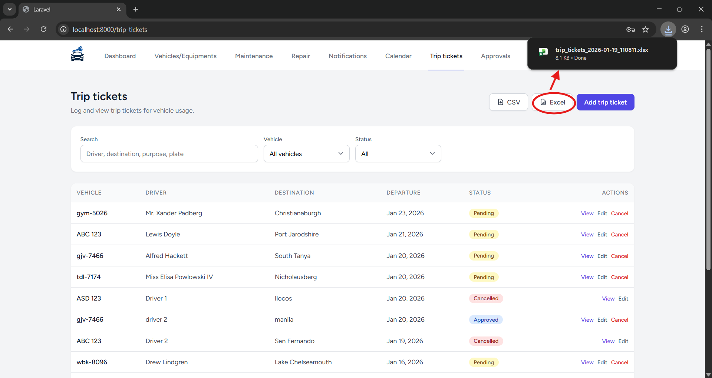
*Figure 7.5: Export Trip Tickets*

---

## 8. Calendar

The Calendar module provides a visual overview of maintenance schedules and trip tickets.

### 8.1 Calendar View

The calendar displays:

- **Maintenance events** – Scheduled and performed maintenance
- **Trip tickets** – Scheduled trips
- **Color coding** – Different colors for different event types

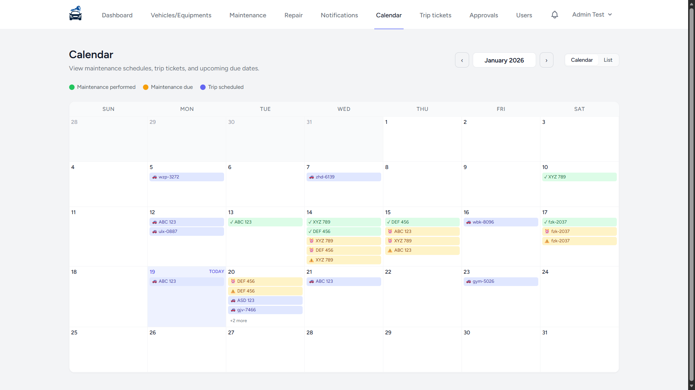
*Figure 8.1: Calendar Month View*

### 8.2 List View

Switch to list view for a tabular display of events.

1. Click the **"List"** button
2. View events in a sortable table format

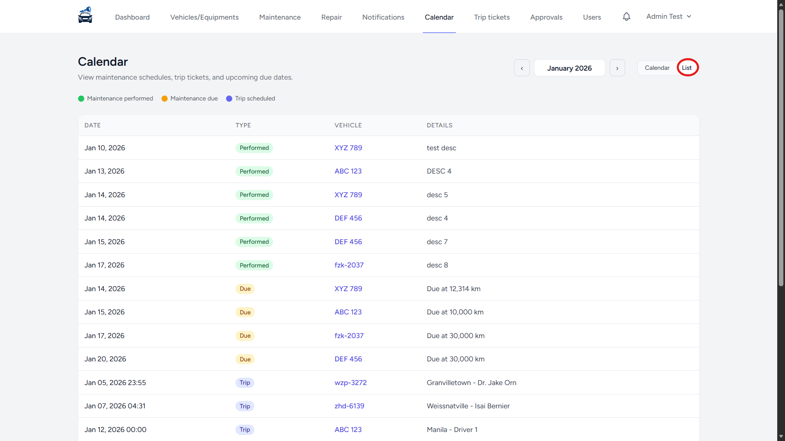
*Figure 8.2: Calendar List View*

### 8.3 Navigating the Calendar

- **Previous Month** – Click the left arrow
- **Next Month** – Click the right arrow
- **Today** – Click the "Today" button to return to current month
- **Toggle View** – Switch between Calendar and List views

*Figure 8.3: Calendar Navigation Controls*

---

## 9. Notifications

The Notifications module tracks all system notifications sent for maintenance reminders.

### 9.1 Viewing Notification Logs

Access notifications from the main navigation menu.

**Information Displayed:**

- Recipient name and email
- Notification type
- Channel (Email)
- Status (Sent, Failed, Pending)
- Sent date and time

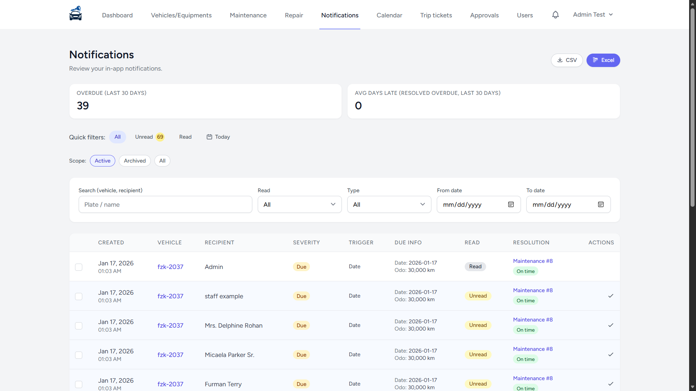
*Figure 9.1: Notification Logs*

### 9.2 Filtering Notifications

Filter notifications by:

- **Status** – Sent, Failed, Pending
- **Channel** – Email
- **Type** – Maintenance due, etc.
- **Date Range** – From and To dates
- **Search** – Search by recipient

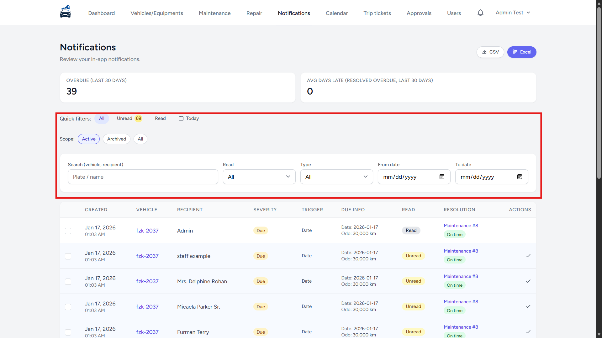
*Figure 9.2: Notification Filters*

### 9.3 Retrying Failed Notifications

For failed notifications:

1. Find the failed notification
2. Click **"Retry"**
3. The system will attempt to resend

*Figure 9.3: Retry Failed Notification*

### 9.4 Archiving Notifications

Archive old notifications to keep the list clean:

1. Select notifications using checkboxes
2. Click **"Archive Selected"**
3. Toggle the archive filter to view archived items

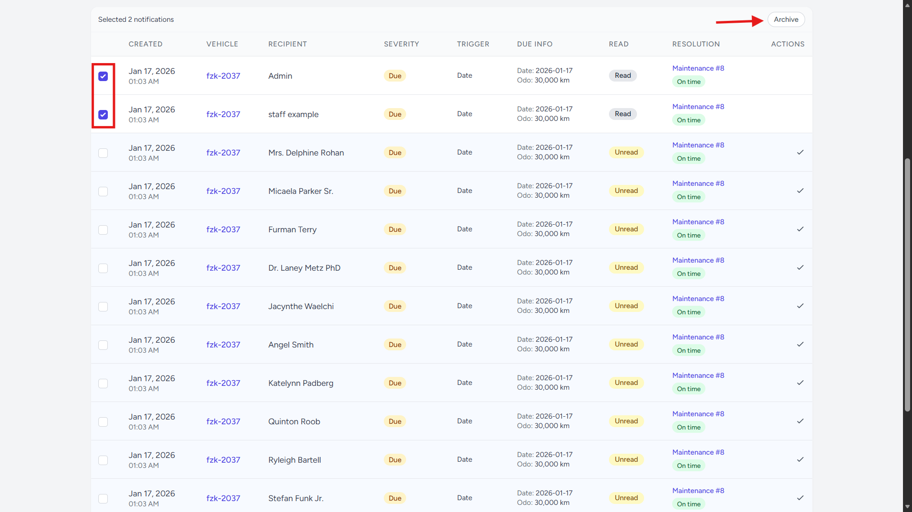
*Figure 9.4: Archive Notifications*

---

## 10. Approval Workflow

The approval workflow ensures that staff submissions are reviewed by administrators before being applied to the system.

### 10.1 For Staff Users

When you (as a staff member) create or edit:
- Vehicles
- Maintenance records
- Repair records
- Trip tickets

Your submission is sent for approval instead of being saved directly.

**Tracking Your Submissions:**

1. Click your profile name in the top-right
2. Select **"My submissions"**
3. View status of all your submissions:
   - **Pending** – Awaiting review
   - **Approved** – Accepted and applied
   - **Rejected** – Declined with notes

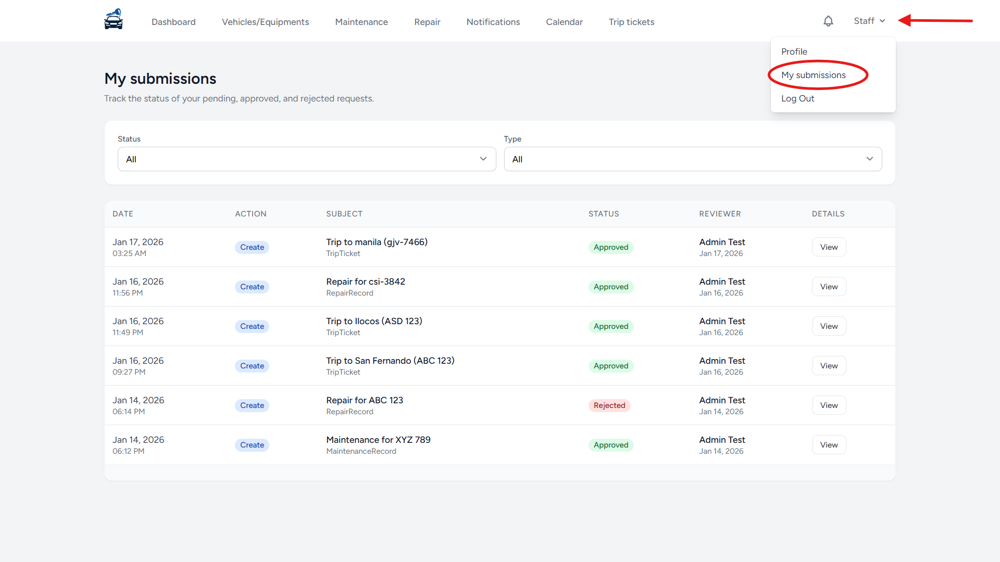
*Figure 10.1: My Submissions Page*

### 10.2 For Administrators

Administrators can review and process pending submissions.

**Reviewing Submissions:**

1. Click **"Approvals"** in the main navigation
2. View all pending requests
3. For each request, click:
   - **"Approve"** – Accept the submission
   - **"Reject"** – Decline the submission
4. (Optional) Add review notes
5. Confirm your decision

**Filters Available:**

- **Status** – Pending, Approved, Rejected
- **Type** – Vehicle, Maintenance, Repair, Trip Ticket
- **Search** – Search by requester or subject

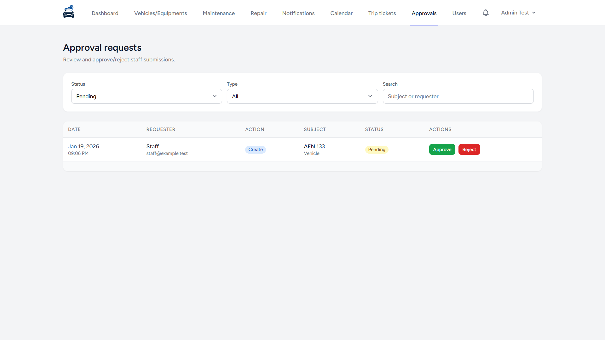
*Figure 10.2: Admin Approvals Page*

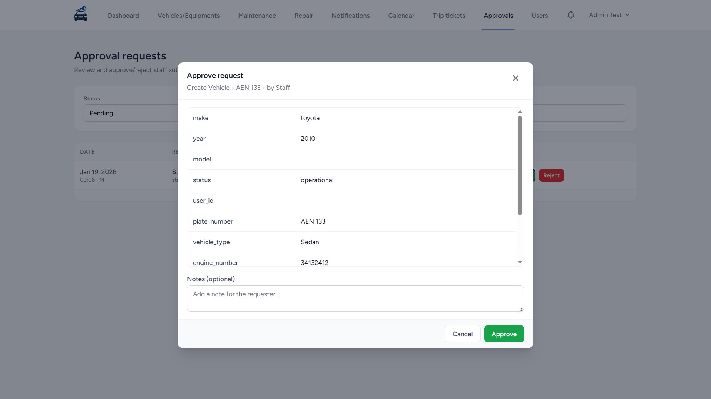
*Figure 10.3: Review Approval Modal*

---

## 11. User Management (Admin Only)

Administrators can manage system users through the Users module.

### 11.1 Viewing Users

Access user management from **Account → Users**.

**Features:**

- **Search** – Search by name or email
- **Filter by Role** – Admin, Staff, User
- **Filter by Status** – Active, Pending, Disabled
- **Sort** – Click column headers to sort

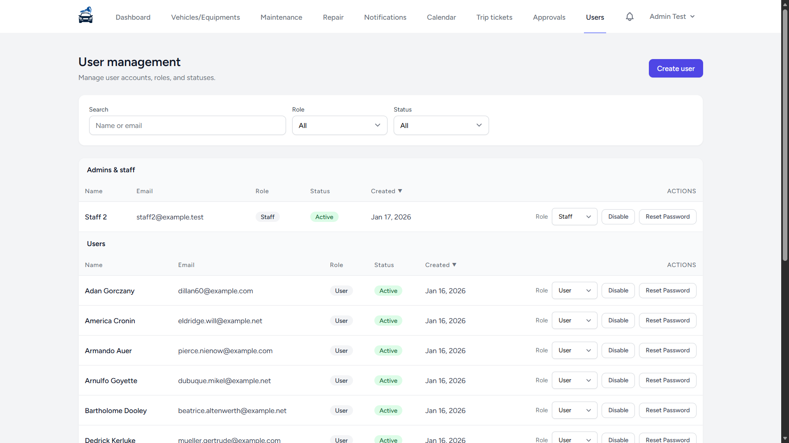
*Figure 11.1: Users List*

### 11.2 Creating a New User

**Steps to Create a User:**

1. Click **"Create user"**
2. Fill in the details:
   - **Name** – User's full name
   - **Email** – User's email address
   - **Role** – Admin, Staff, or User
   - **Status** – Active, Pending, or Disabled
   - **Password** – Initial password
   - **Confirm Password** – Re-enter password
3. Click **"Create"**

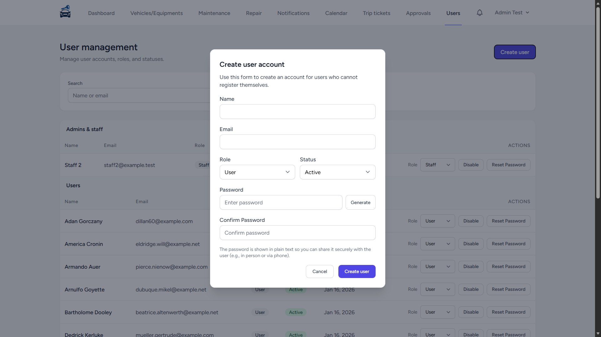
*Figure 11.2: Create User Form*

### 11.3 Approving/Rejecting Users

New registrations require approval:

1. Find users with **Pending** status
2. Click **"Approve"** to activate the account
3. Or click **"Reject"** to decline

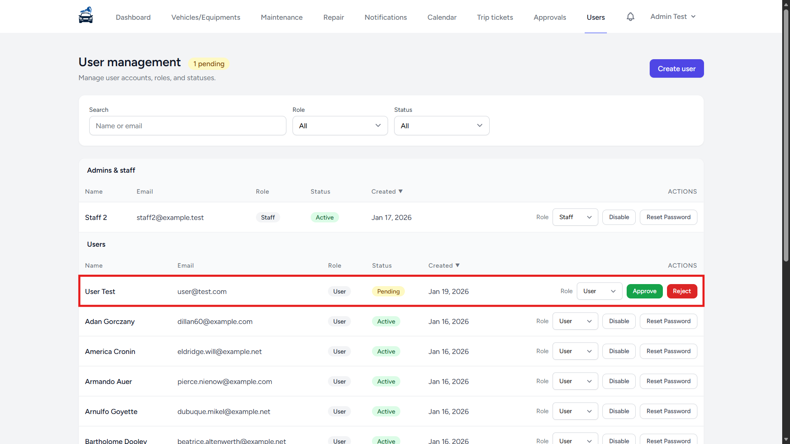
*Figure 11.3: User Approval Actions*

### 11.4 Resetting User Password

**Steps to Reset Password:**

1. Find the user in the list
2. Click **"Reset Password"**
3. Enter the new password
4. Confirm the new password
5. Click **"Reset"**

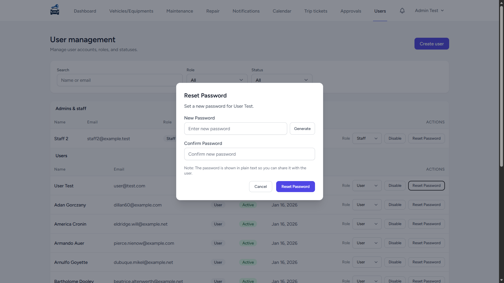
*Figure 11.4: Reset Password Form*

---

## 12. Activity Logs (Admin Only)

The Activity Logs module tracks all significant actions in the system for audit purposes.

**Information Tracked:**

- **User** – Who performed the action
- **Action** – Create, Update, Delete, etc.
- **Subject** – What was affected (Vehicle, Maintenance, etc.)
- **Timestamp** – When the action occurred
- **Details** – Before and after values

**Filtering Options:**

- **Search** – Search by user or description
- **Action** – Filter by action type
- **Subject Type** – Filter by entity type
- **Date Range** – Filter by date

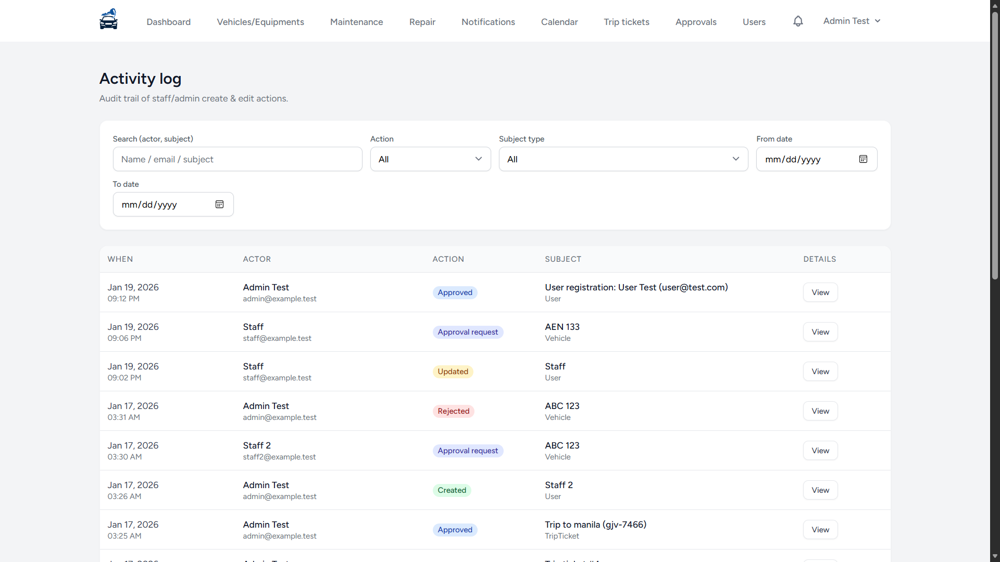
*Figure 12.1: Activity Logs*

**Viewing Details:**

Click on any log entry to view the full details including old and new values.

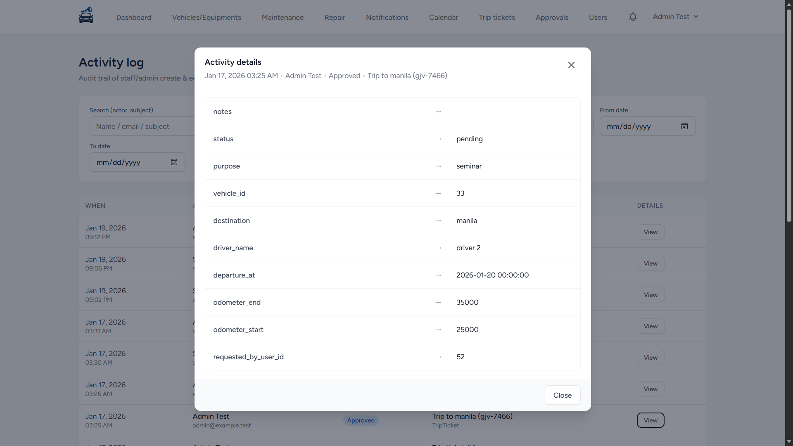
*Figure 12.2: Activity Log Details*

---

## 13. Profile Management

All users can manage their own profile settings.

### 13.1 Updating Profile Information

**Steps to Update Profile:**

1. Click your name in the top-right corner
2. Select **"Profile"**
3. Update your information:
   - **Name** – Your display name
   - **Email** – Your email address
4. Click **"Save"**

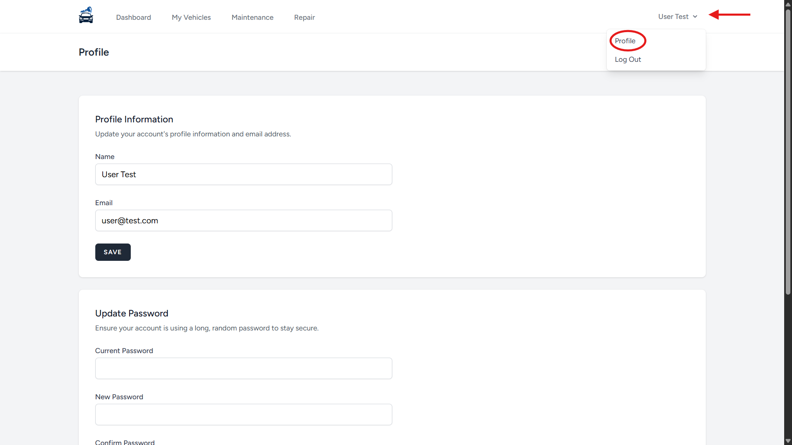
*Figure 13.1: Profile Settings*

### 13.2 Changing Password

**Steps to Change Password:**

1. Go to Profile page
2. Scroll to **"Update Password"** section
3. Enter your **Current Password**
4. Enter your **New Password**
5. **Confirm** the new password
6. Click **"Save"**

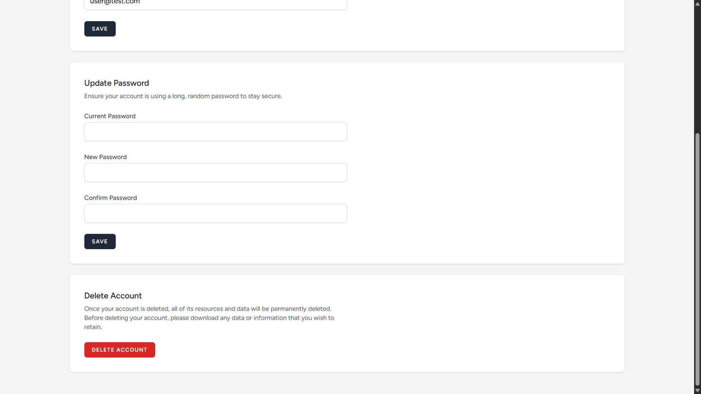
*Figure 13.2: Change Password Form*

---

## 14. User Roles and Permissions

The system has three user roles with different access levels:

### Role Comparison

| Feature | Admin | Staff | User (Driver) |
|---------|-------|-------|---------------|
| View Dashboard | ✅ Full | ✅ Full | ✅ Limited |
| View Vehicles | ✅ All | ✅ All | ✅ Assigned only |
| Add/Edit Vehicles | ✅ Direct | ⏳ Approval | ❌ No |
| Delete Vehicles | ✅ Yes | ❌ No | ❌ No |
| View Maintenance | ✅ All | ✅ All | ✅ Assigned vehicles |
| Add Maintenance | ✅ Direct | ⏳ Approval | ❌ No |
| View Repairs | ✅ All | ✅ All | ✅ Assigned vehicles |
| Add Repairs | ✅ Direct | ⏳ Approval | ❌ No |
| View Trip Tickets | ✅ All | ✅ All | ✅ Own requests |
| Create Trip Tickets | ✅ Direct | ⏳ Approval | ⏳ Approval |
| View Calendar | ✅ Yes | ✅ Yes | ✅ Yes |
| View Notifications | ✅ Yes | ✅ Yes | ❌ No |
| Manage Approvals | ✅ Yes | ❌ No | ❌ No |
| Manage Users | ✅ Yes | ❌ No | ❌ No |
| View Activity Logs | ✅ Yes | ❌ No | ❌ No |
| Export Data | ✅ Yes | ✅ Yes | ❌ No |

**Legend:**
- ✅ – Full access
- ⏳ – Requires approval
- ❌ – No access

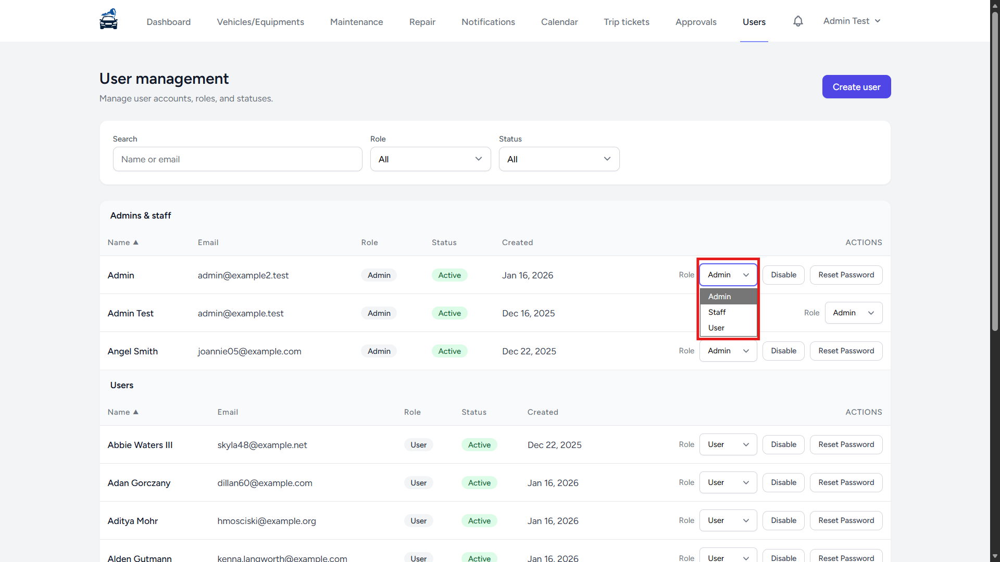
*Figure 14.1: User Roles Overview*

---

## 15. Troubleshooting

### Common Issues and Solutions

#### Cannot Log In

| Problem | Solution |
|---------|----------|
| Invalid credentials | Check email and password, use "Forgot Password" if needed |
| Account pending | Wait for admin approval or contact administrator |
| Account disabled | Contact administrator to reactivate |

#### Submission Not Saving

| Problem | Solution |
|---------|----------|
| Validation errors | Check all required fields are filled correctly |
| Staff user | Your submission was sent for approval, check "My submissions" |

#### Export Not Working

| Problem | Solution |
|---------|----------|
| No download | Check browser's download settings and pop-up blocker |
| Empty file | Ensure there is data to export (check filters) |

#### Page Not Loading

| Problem | Solution |
|---------|----------|
| Slow connection | Check internet connection and try refreshing |
| Session expired | Log in again |
| Server error | Contact system administrator |

*Figure 15.1: Troubleshooting Guide*

### Getting Help

If you encounter issues not covered in this manual:

1. Contact your system administrator
2. Provide details about:
   - What you were trying to do
   - Any error messages displayed
   - Your browser and device type

---

## Appendix

### Keyboard Shortcuts

| Shortcut | Action |
|----------|--------|
| `Esc` | Close modals |
| `Enter` | Submit forms (when focused) |

### Glossary

| Term | Definition |
|------|------------|
| **Odometer** | Vehicle mileage reading in kilometers |
| **Trip Ticket** | Document authorizing vehicle use for a specific trip |
| **PMS** | Preventive Maintenance Schedule |
| **Checklist** | 22-point inspection performed during maintenance |

---

*© 2026 Motorpool System. All rights reserved.*
